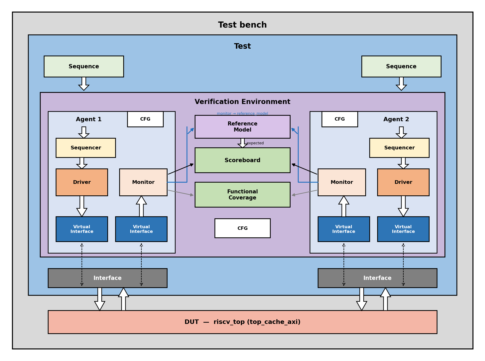
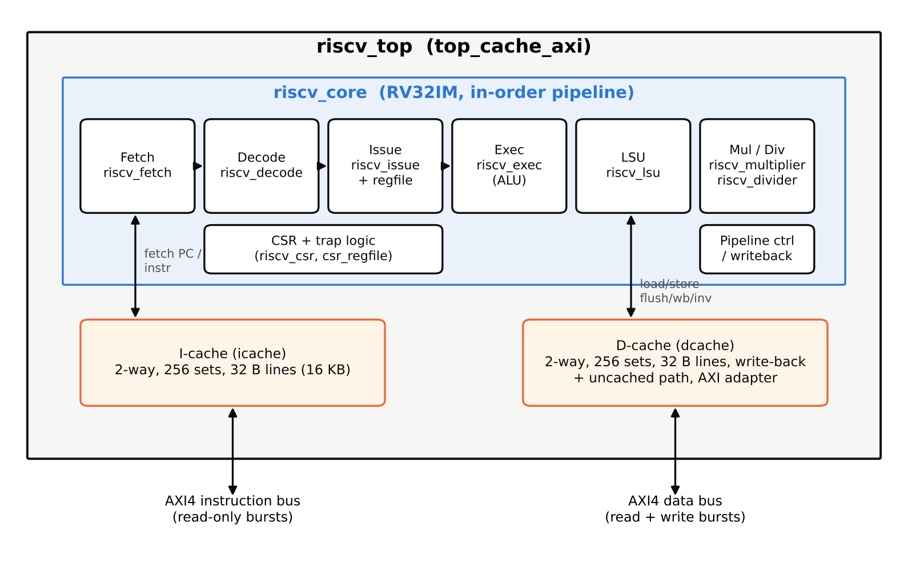
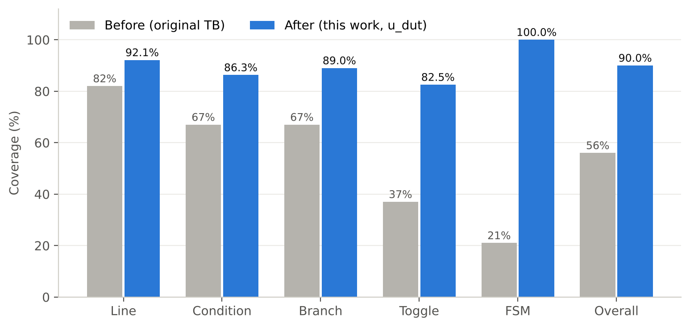
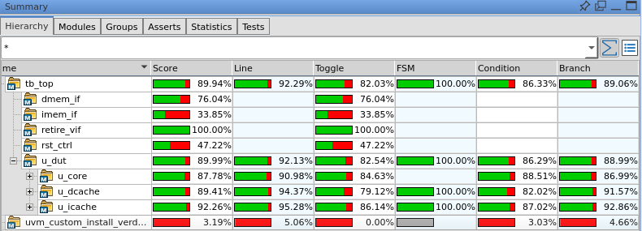
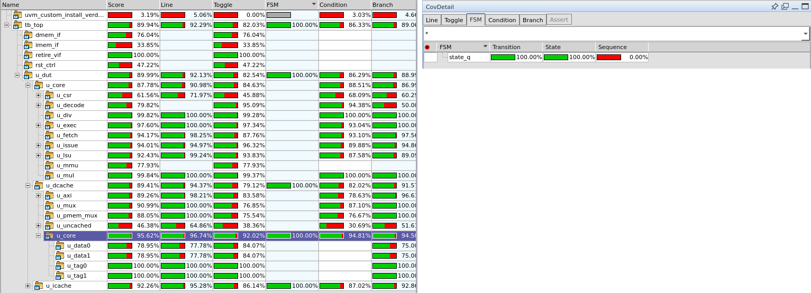
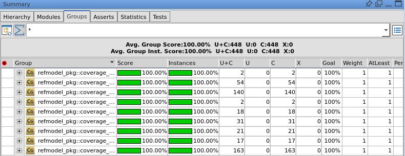

# UVM Verification & Coverage Closure of a RISC-V RV32IM Core with AXI4 Caches

A self-checking **SystemVerilog UVM** testbench for the open-source
[ultraembedded/riscv](https://github.com/ultraembedded/riscv) processor in its
`top_cache_axi` configuration: a 32-bit in-order RV32IM + Zicsr pipeline with
2-way set-associative instruction and data caches and two AXI4 memory ports.

**Results (Synopsys VCS / Verdi, merged 23-run regression, DUT instance `tb_top.u_dut`):**

| Metric | Result |
|---|---|
| Functional coverage | **100 %** (9 covergroups, 448 / 448 bins) |
| FSM coverage (D-cache + I-cache) | **100 %** |
| Overall code coverage score | **89.99 %** |
| Line / Branch / Condition / Toggle | 92.13 % / 88.99 % / 86.29 % / 82.54 % |
| Regression | 23 runs, **0 scoreboard failures, 0 UVM errors** |

---

## Testbench architecture



| Component | Role |
|---|---|
| **imem / dmem agents** | Reactive AXI4 *slave* agents that act as instruction and data memory for the CPU (the CPU is the AXI master) |
| **Retire monitor** | Passive tap on the register-file write port; reports every retired register write (rd, value) |
| **Reference model** | RISC-V ISA model in SystemVerilog: runs the same program and predicts every register write (RV32IM, Zicsr, M-mode traps, CSRs) |
| **Scoreboard** | Strict in-order comparison of predicted vs actual writes; any mismatch, missing or extra write is a `UVM_ERROR` |
| **Coverage collector** | 9 covergroups: instruction/opcode, registers, hazards, loads/stores, M-extension, traps, MRET, extreme values, cache/system ops |
| **SVA** | AXI4 handshake / stability checks on both memory interfaces |
| **Reset injector** | Optional mid-run reset in every cache FSM state, to verify reset recovery |
| **riscv_asm_pkg** | Instruction encoders (`ADDI(...)`, `MULHSU(...)`, `CSRRW(...)`, `ECALL()`) so tests are written as readable assembly, not hex |

Design under test (unmodified upstream RTL):



---

## Tests

| Test | Purpose |
|---|---|
| `riscv_base_test` | Smoke test |
| `riscv_loadstore_test` | Word loads and stores |
| `riscv_muldiv_test` | Basic multiply / divide |
| `riscv_hazard_test` | Back-to-back register dependencies (bypass, load-use stall) |
| `riscv_coverage_test` | Opcode / register coverage |
| `riscv_random_test` | Constrained-random instruction mix |
| `riscv_mega_test` | Long combined program |
| `riscv_byte_half_test` | LB/LH/LBU/LHU/SB/SH at every byte offset, sign/zero extension |
| `riscv_mext_test` | MUL/MULH/MULHU/MULHSU/DIV/DIVU/REM/REMU with 0, ±1, MIN, MAX; divide-by-zero, overflow |
| `riscv_trap_test` | ECALL, EBREAK, illegal instruction, misaligned load/store; trap handler + MRET |
| `riscv_cache_stress_test` | Set conflicts, dirty evictions, flush / write-back / invalidate CSRs, FENCE.I |
| `riscv_extreme_test` | 0, all-ones, MIN, MAX, 0xAAAAAAAA, 0x55555555, walking-1/0 (toggle coverage) |
| `riscv_full_random_test` | Constrained-random mix of every feature (multi-seed) |
| `riscv_reset_test` | Reset injected in each cache state, then checks the program still completes correctly |

---

## Requirements

* Linux
* **Synopsys VCS** (tested with W-2024.09-1) with its built-in UVM 1.2 (`-ntb_opts uvm-1.2`)
* **Synopsys Verdi** (optional, for waveforms and the coverage GUI)

## How to run

```bash
git clone https://github.com/itzmanu2003/<repo-name>.git
cd <repo-name>/sim

make compile                                  # compile DUT + testbench (with coverage enabled)
make run TEST=riscv_trap_test SEED=1          # run one test, prints the scoreboard summary
make newtests SEED=1                          # run the 7 new tests, pass/fail table
./regress.sh 20 riscv_full_random_test        # 20 random seeds of one test (pass/fail only)
./run_coverage.sh                             # full 23-run coverage regression + merge
```

A test passes when the log shows `SCOREBOARD SUMMARY: <n> PASS, 0 FAIL` and `UVM_ERROR : 0`.

### Viewing coverage

```bash
verdi -cov -covdir merged.vdb &              # after ./run_coverage.sh
firefox cov_report/dashboard.html &          # HTML report generated by URG
```

In Verdi, select **`tb_top.u_dut`** in the Hierarchy tab: that is the DUT coverage
(coverage of the testbench itself is not meaningful). The FSM tab of
`u_dut.u_dcache.u_core` shows the D-cache state machine.

### Useful plusargs

| Plusarg | Meaning |
|---|---|
| `+UVM_TESTNAME=<test>` | Test to run |
| `+ntb_random_seed=<n>` | Random seed |
| `+RISCV_TIMEOUT_NS=<n>` | Watchdog timeout (default 3,000,000 ns) |
| `+REF_MAX_STEPS=<n>` | Reference-model instruction limit |

`make clean` removes all generated files.

---

## Coverage results









See [docs/COVERAGE_CLOSURE.md](docs/COVERAGE_CLOSURE.md) for the full coverage-closure
write-up: what was added, testbench bugs found and fixed, mutation testing of the
checker, and the remaining (justified) coverage holes.

---

## Repository layout

```
dut/                     upstream RTL (ultraembedded/riscv, BSD licence) - core + top_cache_axi only
tb/
  agents/imem_agent/     instruction-memory AXI4 slave agent
  agents/dmem_agent/     data-memory AXI4 slave agent
  common/                riscv_asm_pkg (instruction encoders, program builder)
  env/                   environment, virtual sequencer
  interfaces/            AXI4, retire and reset-control interfaces
  refmodel/              reference model, retire monitor, scoreboard, coverage collector
  tests/                 all tests
  top/                   tb_top (DUT instance, clock/reset, SVA, reset injector)
sim/                     Makefile, file list, regression and coverage scripts
docs/                    coverage-closure notes and figures
```

## Credits

* RISC-V core RTL: [ultraembedded/riscv](https://github.com/ultraembedded/riscv) by ultraembedded, BSD licence (see `dut/LICENSE`).
  Only the files needed for the `top_cache_axi` configuration are included; the RTL is unmodified.
* UVM testbench, tests, reference model and coverage closure: Manu G K.
